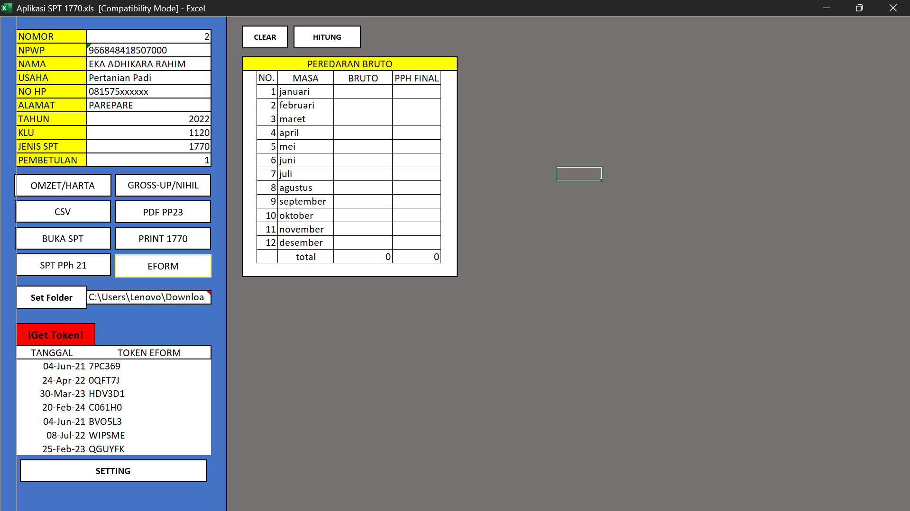
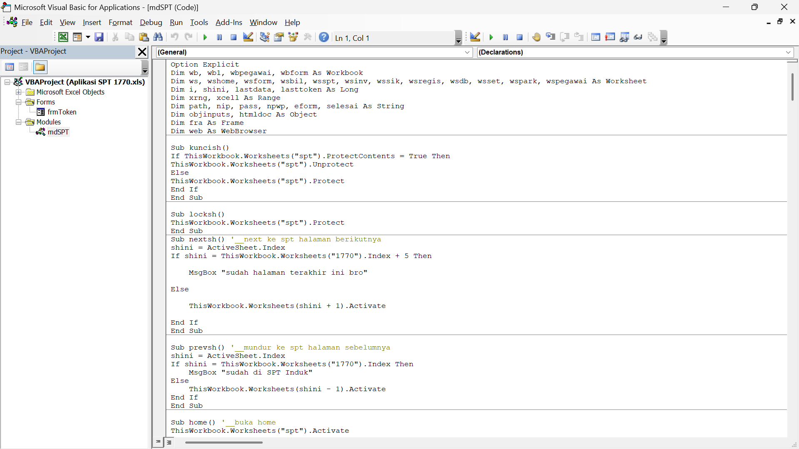

# Helper SPT Tahunan 1770 & E-Form

Project ini saya cicil dari akhir 2021 sampai akhir 2022 waktu masih di KP2KP Pinrang. 

Latar belakangnya sederhana: tiap masuk musim lapor SPT Tahunan (Januari sampai Mei), beban kerjaan asistensi itu bisa naik hampir 4x lipat dibanding hari biasa, khususnya buat Wajib Pajak usahawan yang lapor pakai E-Form. Karena kerjaannya diulang-ulang terus setiap hari, lama-lama cuma ngandelin *muscle memory* dan rawan salah ketik (*human error*). Dari situ saya coba bikin alat bantu pakai VBA Excel ini.

### Tampilan Aplikasi & Kodingan

### Daftar Fitur

Waktu saya buka lagi file VBA-nya, kurang lebih ada 11 fitur yang dulu saya masukin ke dalam Excel ini:

1. **Fullscreen otomatis (`ThisWorkbook.bas`)**
   Pas file pertama dibuka, makro langsung nyembunyiin formula bar, status bar, scroll, sama tab sheet di bawah. Tujuannya biar tampilannya lebih rapi dan meminimalisir user gak sengaja salah pencet bagian lain yang bikin rumus error.

2. **Autoclear login SIKKA (`ThisWorkbook.bas`)**
   Karena fitur penarik token di aplikasi ini butuh login internal, saya tambahin fungsi keamanan sederhana. Setiap file ditutup, aplikasi nyimpen *path* lokasi folder terakhir. Kalau file Excel ini dipindah atau dikirim ke komputer lain (*path*-nya berubah), isian login di sheet setting bakal otomatis kehapus bersih.

3. **NPWP cleansing (`Sheet6_spt.bas`)**
   Kalau user *copy-paste* NPWP yang masih ada tanda titik dan stripnya (misal `12.345.678.9-123.456`) ke kolom NPWP, otomatis dibersihin jadi angka doang biar rapi dan gampang kalau mau dipakai vlookup.

4. **Tombol hide/unhide fitur (`showOmzet` & `showGrossup`)**
   Tabel-tabel kaya omzet/harta sama gross-up/nihil itu sebenernya saya bikin berjejer menyamping di satu sheet yang sama. Di tombol menunya saya kasih fungsi buat *hide/unhide* kolom, jadi layar utamanya tetep keliatan ringkas dan cuma nampilin tabel yang lagi mau dipakai aja.

5. **Kalkulator 2 arah (`Sub hitung`)**
   Ini bagian logika koding yang waktu itu paling seru buat latihan otak. Kolom `bruto` sama `pph final` saya bikin saling nyambung. Kalau kita isi nominal omzet terus klik hitung, kolom PPh final bakal keisi otomatis sesuai tarif. Begitu juga sebaliknya, kalau WP cuma bawa bukti bayar PPh-nya doang, kita isi kolom PPh finalnya maka kolom omzet di sebelahnya otomatis ngitung balik.

6. **Generator CSV daftar omzet dan harta (`Sub makecsv`)**
   Di E-Form, ngisi penghasilan omzet UMKM itu harus diketik satu-satu per bulan. Untungnya ada fitur impor CSV di E-Form, jadi saya bikinin tombol buat nge-generate tabel omzet (dan daftar harta) di Excel tadi langsung jadi file `.csv` berpemisah titik koma (`;`) yang siap diimpor.

7. **Export PDF lampiran PP 23 (`Sub pdfomzet`)**
   Selain isi omzet, WP usahawan juga wajib upload PDF lampiran rincian omzet. Daripada harus nyiapin template, cetak kertas, terus scan manual lagi, lewat tombol ini daftar omzet yang udah diinput tadi langsung ke-export jadi file `LAPOR.pdf` yang siap di-upload.

8. **Pembuka E-Form otomatis (`Sub bukaEFORM`)**
   Fitur minor buat langsung buka file PDF E-Form yang barusan di-download dari DJP Online sesuai format penamaan filenya.

9. **Tabel hitung Gross-up & Nihilisasi (`Sub buatNIHIL` & `Sub grossup`)**
   Simulasi hitung cepat pakai fungsi `.GoalSeek` bawaan Excel yang dijalanin lewat makro.

10. **Cetak fisik SPT 1770 dan 1721 (`Sub printSPT`)**
    Buat cetak formulir SPT fisik (6 lembar berurutan untuk 1770) yang di dalamnya udah otomatis keisi nama, NPWP, alamat, sampai rincian omzet dan aset sesuai inputan di halaman depan.

11. **Token E-Form generator (`Sub GetCode` & `frmToken.bas`)**
    Ini fitur yang bikinnya paling lama dan paling bikin pusing waktu itu. Inspirasinya dari aplikasi Excel internal lain yang bisa narik data dari web, terus saya coba pelajari dan terapkan buat ngambil token E-Form dari web monitoring internal. Jadi petugas gak perlu buka browser dan input manual lagi, cukup sekali klik sambil nunggu *loading bar* buatan sendiri jalan sampai 100%.

---

### File Excel, Panduan, & Isi Folder `src/`

Kalau mau coba buka langsung aplikasinya atau lihat buku panduan yang dulu pernah saya bikin buat teman-teman kantor, filenya ada di sini:
- **[`Aplikasi SPT 1770.xls`](./Aplikasi%20SPT%201770.xls)** (file Excel aplikasi, password VBA sudah dibuka).
- **[`Panduan Aplikasi SPT 1770.pdf`](./Panduan%20Aplikasi%20SPT%201770.pdf)** (dokumen tutorial penggunaan aplikasi).

Karena file `.xls` gak bisa langsung dilihat kodingannya di browser GitHub, modul VBA-nya juga saya export ke bentuk teks di folder [`src/`](./src):
- [`mdSPT.bas`](./src/mdSPT.bas) - Kodingan utama (kalkulator 2 arah, export CSV/PDF, goal seek, sampai fungsi *scraping* token).
- [`frmToken.bas`](./src/frmToken.bas) - Kodingan buat tampilan loading bar pas narik token.
- [`ThisWorkbook.bas`](./src/ThisWorkbook.bas) - Kodingan buat fullscreen otomatis dan reset login kalau file pindah folder.
- [`Sheet6_spt.bas`](./src/Sheet6_spt.bas) - Kodingan buat bersihin titik dan strip waktu input NPWP.

*(Catatan: Untuk alamat link internal di dalam `mdSPT.bas` sudah saya ganti tulisannya jadi `INTERNAL_MONITORING_HOST` supaya aman).*
